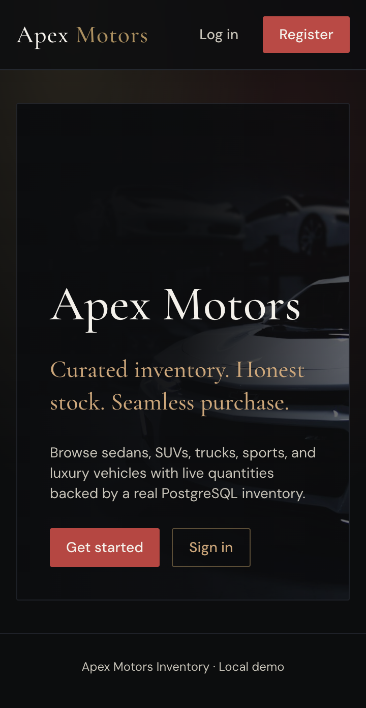
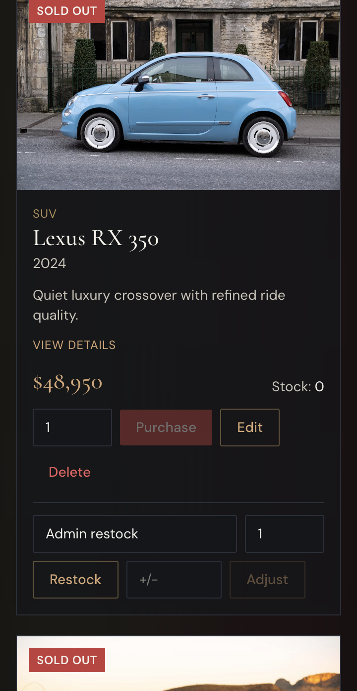
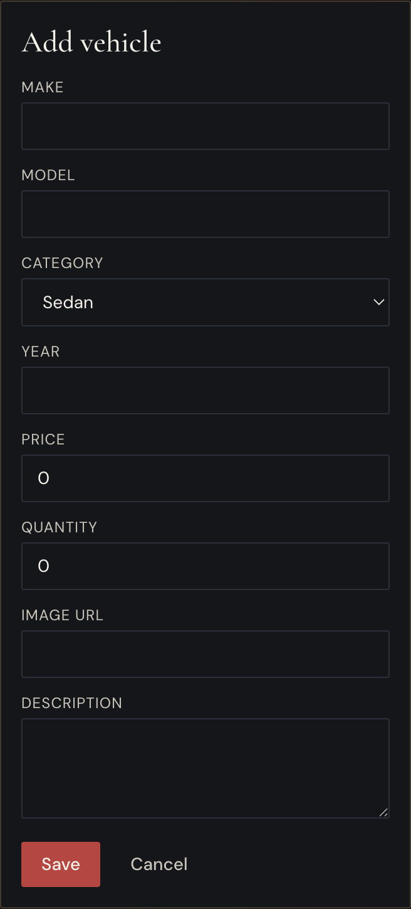

# Apex Motors Car Dealership Inventory

A React/Vite frontend and TypeScript/Express API for browsing and managing a PostgreSQL-backed vehicle catalogue.

## Features

- JWT authentication with bcrypt password hashing and user/admin roles.
- Vehicle listing, search, admin CRUD, and sold-out inventory display.
- Atomic purchases with conditional stock decrement, permanent stock movement history, and admin restocking/adjustments.
- Inventory KPIs, category and sales summaries, low-stock filtering, pagination, and CSV exports.
- PostgreSQL migrations and idempotent sample seed data (12 vehicles, five categories, including two sold-out entries in a fresh seed).

## Setup

Requirements: Node.js 20+, npm, and Docker with Compose (or a compatible PostgreSQL 16 instance).

1. Copy `.env.example` to `.env` and set a long `JWT_SECRET` and local database values.
2. Start PostgreSQL with `docker compose up -d db db_test`.
3. Install dependencies with `npm install`.
4. Run `npm run db:migrate` and `npm run db:seed`.
5. Start the API with `npm run dev:backend` and the frontend in a second terminal with `npm run dev:frontend`.

The API is served at `http://localhost:3001`; the frontend is served at `http://localhost:5173`.

The test database uses port 5433 and `dealership_test`. Do not point tests at a database containing development or user data.

## Verification

Run the available checks with:

```bash
npm run lint
npm run typecheck
npm run test
npm run build
```

Verified on 2026-10-25: lint passed, typecheck passed, backend tests passed (29/29), frontend tests passed (3/3), and the production build passed. PostgreSQL migration and repeat seed verification passed. The configured development database currently contains 12 models across five categories and three sold-out vehicles; existing data was preserved. Docker was not required because PostgreSQL was already running locally.

See [REPORT.md](./REPORT.md) for the verification report and known submission limitations.

## Screenshots







## My AI Usage

This continuation used repository file inspection, shell diagnostics, targeted patch application, npm scripts, Vitest, ESLint, TypeScript, Vite, PostgreSQL, and curl. Outputs were validated against the source, tests, database counts, seed rerun behavior, and live API responses. The original raw AI chat logs were not present in the repository; see [PROMPTS.md](./PROMPTS.md) for the honest owner-confirmation marker.

The implementation was reviewed by inspecting the changed source and by rerunning the relevant automated checks. Personal assessment of the AI-generated changes and any manual edits remains [OWNER TO CONFIRM].
# incubyte
